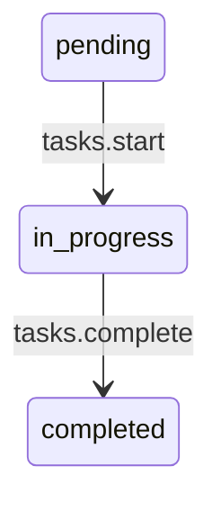
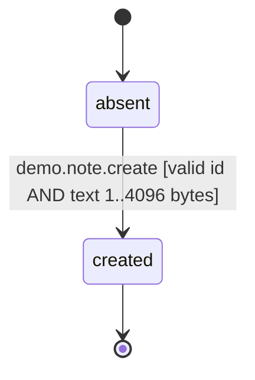

# Declarative business state machines — bounded first milestone

**Design for review, with a small executable Rust core.** The user's intended
authoring languages are Python and TypeScript. Applications compile to a closed
declarative IR, and the installed runtime operates in Rust without a Python or
JavaScript interpreter. This is not conversion of arbitrary Python/TypeScript
functions, and the full SDK/compiler/registry is not implemented in this milestone.

## Deny by default means invalid, not null

A business transition is invalid unless the machine explicitly declares its
current-state/event pair and all typed guards pass. Invalid input yields no
mutation plan: no object write, no null write, and no domain event. There is no
implicit transition, fallback handler, wildcard, or automatic self-loop.

Authentication, tenant scope, operation idempotency, persisted revision/state
checks and atomic commit remain mandatory independent engine gates. A valid FSM
edge does not grant permissions. A rejected accepted command may still acquire
an operation-rejection/inbox audit record so delivery can terminate; this is not
a business transition and must not create an object or domain outbox event.

Reads and queries are not business transitions. They still require their normal
authorization and isolation checks and cannot mutate domain state.

## Closed IR version 1

Canonical registrations: `runtime/machines/tasks.json` is the requested tasks example;
`runtime/machines/demo-note.json` preserves the original note fixture.

- `schema_version`: integer 1, rejects unsupported versions.
- `id`, `collection`: bounded identifiers.
- `states`: unique bounded identifiers (1–256).
- `initial_state`: one declared state. For the note fixture, `absent` is a
  logical state derived from absence of the object, not a row written at startup.
- Optional `state_labels`: display-only text keyed by declared states (bounded
  to 128 UTF-8 bytes, no control characters). Translations cannot change logic.
- `terminal_states`: unique subset of states. Terminal states cannot have
  outgoing transitions. A machine may start terminal and deny all transitions.
- Optional `creation`: typed `{event, initial_state, actions}` object. The event
  cannot also name a transition; the initial state must equal the machine's
  declared initial state. Creation requires exactly one matching create_object,
  allows valid nonduplicate emitted events, and cannot contain set_state.
  Missing creation means initialization is not declared by this descriptor.
- `transitions`: explicit `from`, `event`, `to`, `guards`, `actions` (up to 1024).
- Multiple transitions with the same `(from,event)` are rejected **even if their
  guards look disjoint**. No first-match priority or predicate theorem prover.
- All guards use AND. Empty guards explicitly mean unconditional *for that
  declared edge only*. No edge still means deny.
- Actions are nonempty, bounded and enumerated; unknown fields/variants and null
  where a typed value is required fail deserialization/validation.

Typed guards currently available:

| Kind | Input | Semantics |
| --- | --- | --- |
| `valid_identifier` | `input.id` only | Runtime identifier validator |
| `string_length` | `input.text` only | Inclusive min/max UTF-8 **byte** length; min ≤ max ≤ 4096 |

Allowed action proposals:

| Kind | Parameters | Boundary |
| --- | --- | --- |
| `create_object` | `object_type` equals machine collection | At most once per edge; engine validates/persists |
| `emit_event` | `event_name` valid identifier | Duplicate event names rejected; engine writes outbox atomically |
| `set_state` | `state` exactly equals the declared transition target | At most once per edge; engine checks persisted state/revision before commit |

These are closed instruction types, not raw SQL, expression strings, shell
commands, import paths, network actions or callbacks. The core is structurally
reusable for several state graphs but its input vocabulary is deliberately the
current `Note { id, text }`, not a generic field/type system. Arbitrary schemas,
transformations, updates, effect handlers and guards require later reviewed
extensions to the instruction vocabulary.

## Requested tasks example: three states, two transitions

The displayed labels are **Pendiente**, **En progreso**, **Completada**. The
identifiers remain `pending`, `in_progress`, `completed` in all serializations.
`tasks.start` proposes `set_state(in_progress)` plus
`emit_event(tasks.task.started)`; `tasks.complete` proposes
`set_state(completed)` plus `emit_event(tasks.task.completed)`.
`completed` is terminal. Completing a pending task, starting an already started
or completed task, and all undeclared events are invalid by default.

The same tasks JSON object explicitly declares `creation.event = tasks.create`,
`creation.initial_state = pending` and actions `create_object(tasks.task)` plus
`emit_event(tasks.task.created)`. The storage adapter consumes this descriptor.
`tasks.create` explicitly initializes a new task in the declared initial state;
it is not a hidden FSM edge and is not accepted by `evaluate`. Initialization
must have its own validated, authorized create-only storage path. A task does
not exist before initialization; existing tasks are changed only by declared
transitions. This is deliberately distinguished from ordinary reads.

The core currently shares the bounded input vocabulary `Note {id,text}` for
compatibility. Task transitions use only the identifier guard and pass an empty
unused text field. This is not an invented generic payload schema system.

## Preserved note fixture

The sole edge proposes `create_object(demo.note)` and
`emit_event(demo.note.created)`. `created` is terminal. No delete/update/archive
operation is implicitly installed. The integration must check this exact supported
profile before executing proposals, rather than silently ignore unhandled actions.

The original note SQLite `objects` key does not include collection type. The
tasks integration uses separate `task_*` tables and a `task_objects` scoped key
that includes collection. It does not put tasks into the old note table or
silently migrate the note fixture. This bounded separation is not a general
multi-collection registry; storage integration tests are separate from core FSM
tests.

## Reviewable JSON Schema

[`runtime/machines/machine.schema.json`](../../runtime/machines/machine.schema.json)
uses JSON Schema draft 2020-12 to describe this versioned, closed object model.
Unknown object fields/actions/guards are rejected. `creation` is optional and can
be JSON `null`, matching Rust `Option::None`; other required typed values cannot
be replaced by null. Labels are metadata rather than instructions.

The schema is a structural validation aid, **not an alternative runtime
validator**. `CompiledMachine` remains authoritative for references to states,
terminal-source prohibition, ambiguous `(state,event)` pairs, creation-event
conflicts, action/type/target equality, guard min/max ordering and UTF-8 byte
limits. JSON Schema string lengths count characters, not bytes; Rust checks the
actual byte limit. Rust parsing also checks its numeric representation/ranges
and caps source size before parsing.

[`schema-validation.json`](../../runtime/machines/schema-validation.json) records
schema self-validation, both installed JSON fixtures, six rejected structural
mutations and explicit null-creation acceptance. It also records that an unknown
initial-state reference can pass structural validation and still must fail Rust
semantic validation. These checks do not execute transitions or certify storage.

## JSON/TOML parity fixture

`tasks.json` remains the editable source for the installed task machine.
`runtime/machines/tasks.generated.toml` is generated from that JSON object and
is read-only evidence of an equivalent serialization, not an independent model
or version. Regenerate it after changes to the source; do not maintain both by
hand. Rust tests compile both files and compare complete typed IR objects and
valid/invalid transition results, so drift fails tests.

`CompiledMachine::from_json` and `from_toml` both enforce a 1 MiB source limit,
parse into the same `MachineIr`, and call the same validator/compiler. Neither
format can introduce extra actions, code or event transitions. This adds no CLI
or authoring SDK and does not assert canonical serialized byte equality.

## Evaluation and transaction boundary

`CompiledMachine::compile(MachineIr)` validates and indexes the IR.
`evaluate(state,event,&Note)` is pure and returns a `TransitionPlan` or an explicit
error; the plan contains source state, target state and typed actions.
`note_machine()` and `task_machine()` validate their embedded JSON once via `OnceLock`. There is no
network fetch, runtime code execution or dynamic file reload.

Inside the actual mutation transaction the engine must:

1. Resolve persisted scope, identity and object state; never trust caller state.
2. Recheck authorization and delivery/idempotency identity.
3. Evaluate the declared transition against that state.
4. Validate every proposed action and any revision/precondition.
5. Commit the complete domain state, operation, inbox and outbox atomically.

The bounded SQLite adapter uses BEGIN IMMEDIATE to serialize state and expected-revision
validation with task create/update, terminal operation, inbox and outbox. It is not
a generic distributed CAS engine. A terminal
operation replay is an idempotent delivery acknowledgement; it does not execute a
new `created → created` transition. A new command trying the same create is a new
invalid transition and must produce no domain effects. The existing command
rejection/status codes remain part of the HTTP contract.

## Canonical language-neutral business objects

The business logic is the typed, versioned object model (AST/FSM), independent
of its authoring language. Python and TypeScript are builders/readers of the
**same model**, not callback runtimes. TOML and JSON are serializations of those
objects, not separate semantic definitions. There are no language-specific
callbacks or embedded interpreters in the normal execution path.

The target architecture derives the Rust execution plan, HTTP/OpenAPI contract,
Protobuf/gRPC contract, client SDKs and dashboard from that common model. This
milestone does **not** already provide that pipeline: it embeds two small JSON FSMs,
generates task event/state/label OpenAPI descriptors and dashboard diagrams from
the installed tasks IR. The base note contract and bounded input DTO shapes remain
explicit adapter code; this is not a generic entity/type compiler. A complete neutral-model compiler, canonical
serialization/release hashing, schema generation and Protobuf generation remain
future work. No canonical byte-order/release-hash guarantee is asserted yet.

## Two different kinds of SDK

### Authoring SDKs: Python/TypeScript → IR

**Planned, not implemented.** These express entities, machine states, events,
guards and allowed actions as typed declarations and emit the same versioned IR.
A common validation/compiler layer must reject unknown constructs and normalize
semantics. Python/TypeScript code executes only while constructing the declaration;
its arbitrary runtime behavior is not transported into Rust.

No SDK exists yet, so illustrative syntax must be presented as a proposal, not
as an importable library. Equivalent Python and TypeScript declarations must
produce equivalent normalized IR and pass the same Rust conformance fixtures.

### Client SDKs: Python/TypeScript → HTTP backend

**Separate planned deliverable.** These can be generated or implemented from the
real served `GET /openapi.json` contract (base template plus installed IR) to submit commands/read operations and objects.
They do not define business machines or bypass the backend's permissions,
idempotency or transaction boundary. Current HTTP endpoints remain usable without
an SDK through any ordinary HTTP client.

### gRPC

Not implemented. OpenAPI does not itself supply a native gRPC interface. A future
gRPC adapter requires an explicit Protobuf/service contract and parity tests for
authentication, scopes, operation acceptance, idempotency, errors and reads against
the same engine. It must not become an alternate path around transition validation.

## Validation scope

Rust core tests cover explicit plans, denied unknown/terminal edges, typed guard
failure, malformed/ambiguous machines, forbidden fields/actions, and pure no-plan
results for invalid events/reads. Integration tests must separately prove no
business writes/outbox events on rejection and replay safety under real storage.
Core tests also prove explicit creation validation/event disambiguation,
JSON/TOML semantic round-trip, the exact three task states
and two edges, display-label independence, and target-state action consistency.

No SDK, general multi-collection migration, generic registry, gRPC service, arbitrary
language execution, cloud adapter or deployment is implied by this milestone.
