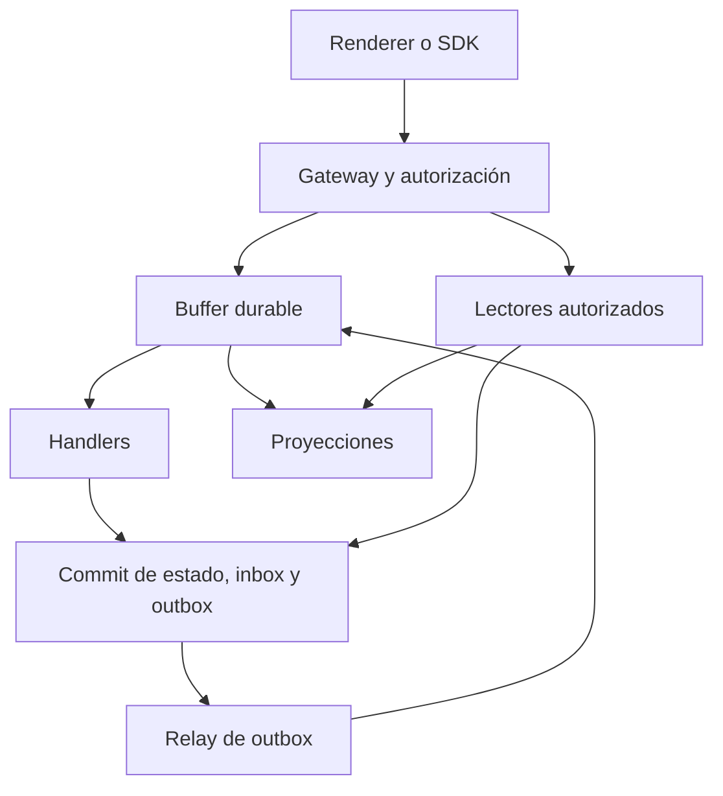

# Especificación del framework

Versión `0.1.0-draft.1`. Fecha: 22 de octubre de 2026. Estado: propuesta revisable.

## 1. Objeto, alcance y vocabulario

El sistema es un framework para describir aplicaciones mediante datos y ejecutar su comportamiento a través de mensajes durables. Las definiciones de entidades, validaciones, eventos, handlers, políticas, vistas y motores se compilan a una representación intermedia común. El core decide reglas de dominio; los adaptadores resuelven almacenamiento, transporte, identidad, ejecución y presentación.

El objetivo inicial es que una misma definición pueda ejecutarse localmente y en un entorno como Lambda, usando distintos motores y sin obligar al frontend a adoptar un renderer concreto. La primera implementación de referencia propuesta utiliza SQLite y un proceso local. Rust, WASM, Lambda y los SDK específicos permanecen como elecciones de implementación, no como requisitos del lenguaje declarativo.

| Concepto | Significado |
| --- | --- |
| Definición | Documento versionado que describe un tipo, handler, vista, permiso o binding. |
| Comando | Solicitud de una acción que puede aceptarse, rechazarse o fallar. |
| Evento | Hecho confirmado, publicado después de su commit. |
| Buffer | Abstracción durable de ingreso, enrutamiento y entrega de mensajes. |
| Handler | Función de aplicación que procesa un mensaje y propone cambios y nuevos mensajes. |
| Motor | Implementación de capacidades primitivas de infraestructura. |
| Rol de motor | Uso de un motor como persistencia, blob, cola, log, caché o proyección. |
| Adaptador | Composición que expone un puerto usando capacidades de uno o varios motores. |
| Proyección | Vista de lectura derivada; puede retrasarse respecto del estado confirmado. |
| Negocio | Tenant y frontera principal de aislamiento. |
| Proyecto | Aplicación o espacio de definiciones dentro de un negocio. |
| Cliente | Cuenta comercial o grupo de recursos de un negocio; no equivale a usuario. |
| Principal | Identidad humana o de servicio autenticada. |
| Membresía | Asociación explícita entre principal y negocio, con ámbitos y perfiles. |
| Perfil | Conjunto versionado de permisos asignables; no implica una jerarquía numérica. |
| Sesión | Contexto autenticado más el ámbito activo. |
| ViewModel | Estado de una vista: datos, borradores, errores y operaciones pendientes. |

Quedan fuera del primer incremento: transacciones distribuidas entre motores, sincronización offline de escrituras, inferencia de esquemas desde datos, permisos heredados entre negocios, reglas con código arbitrario y entrega global exactamente una vez. No se promete una latencia ni un costo antes de medirlos.

## 2. Requisitos establecidos y propuestas

Los acuerdos visibles son: orientación a eventos; handlers sin llamadas directas a otros handlers; independencia de lenguaje e infraestructura; archivos TOML para configuración y credenciales mediante `.env`; definiciones de nuevas entidades, vistas y eventos con TOML o TOON; motores con roles y compatibilidad explícita; múltiples negocios y clientes; usuarios, perfiles y autorización extensibles; HTML/htmx como opción; sesión y MVVM; biblioteca utilizable desde frontend o backend e integración posible con Vite, Astro, Preact y React.

Las siguientes decisiones concretan esos acuerdos y se proponen para la versión inicial: diferenciar comandos y eventos, adoptar sobres CloudEvents para hechos, usar JSON como intercambio, exigir outbox/inbox, admitir duplicados, usar RBAC más condiciones de atributos, hacer asíncronas las mutaciones HTTP y comenzar con un adaptador local. Su motivación, impacto y estado se registran en [DECISIONS.md](DECISIONS.md).

Un acuerdo sobre archivos declarativos no implica que TOML o TOON sean lenguajes de ejecución. Tampoco que cualquier motor pueda ofrecer cualquier rol sin añadir coordinación.

## 3. Arquitectura y separación de responsabilidades

El gateway autentica, establece el ámbito, valida la forma y acepta comandos. El dispatcher selecciona handlers a partir de sus suscripciones. Un handler no conoce qué función consumirá el mensaje que emite. Los lectores consultan puertos de lectura; no invocan handlers. Las llamadas internas a validadores, evaluadores, repositorios y otras funciones puras son compatibles con la prohibición de llamadas entre handlers de aplicación.

La transición de un handler se modela como:

\[
H(m,s,c)\longrightarrow(\Delta s,M,o)
\]

Aquí `m` es el mensaje recibido; `s`, el estado leído con revisiones; `c`, el contexto autorizado; `Δs`, los cambios propuestos; `M`, los mensajes de salida; y `o`, el resultado de la operación. El runtime valida y confirma el conjunto. La función no confirma por su cuenta ni publica mensajes antes del commit. Reloj, identificadores y efectos externos se introducen por puertos explícitos.

El core debe depender de interfaces pequeñas. Persistencia no debe exigir funciones de blob o cola; el puerto de cola no debe presuponer tablas SQL. Un adaptador solo puede sustituir otro si preserva la semántica requerida, incluidos concurrencia, recuperación y errores, además de los nombres de los métodos.

## 4. Ámbitos, identidad y aislamiento

Para datos de cliente, el ámbito completo es:

\[
S=(business\_id,project\_id,client\_id).
\]

Un objeto se identifica mediante `(S,type,id)`. Una revisión identifica su estado confirmado. El catálogo de definiciones pertenece a `(business_id,project_id)` y se publica de forma coherente; una definición compartida no concede acceso a los datos de todos los clientes.

Los recursos administrativos a nivel de negocio o proyecto tienen otro tipo de ámbito declarado. Un `client_id` ausente nunca significa «todos los clientes». Las operaciones de datos de esta versión requieren los tres componentes. No hay referencias de objetos entre ámbitos en el primer incremento.

La identidad de un usuario puede ser global, pero sus membresías y permisos son locales a cada negocio. Un cliente puede tener varios usuarios y un usuario puede pertenecer a varios negocios y clientes. Cambiar el contexto activo exige verificar una membresía válida. La pertenencia a un negocio no se deduce de un identificador recibido en JSON o de un claim sin verificar.

Los identificadores del ámbito deben estar presentes en claves de persistencia, índices, operaciones, caché, inbox, outbox, cursores y autorización de suscripciones. La identidad del tenant recibida en un evento se acepta solo desde un productor de infraestructura autenticado y un binding autorizado; la envoltura declarativa no es una prueba de identidad.

Los recursos de otros ámbitos devuelven `404` para reducir enumeración; permisos insuficientes sobre un ámbito conocido pueden devolver `403`. Las respuestas, errores y métricas no deben revelar datos de otro ámbito.

## 5. Lenguaje declarativo y compilación

El pipeline normativo es `parsear → normalizar → validar estructura → resolver referencias → verificar semántica → planificar capacidades → producir release inmutable`. Los documentos desconocidos, claves no reconocidas y referencias no resueltas provocan errores con ruta y código. No se evalúa texto como código.

Cada definición posee `api_version`, `kind`, `id` y `version`. `api_version = "framework/v1alpha1"` versiona el lenguaje; `version` versiona esa definición. La versión del framework, el contrato HTTP, el evento y la definición son independientes. Un release contiene una lista coherente de documentos y un hash de contenido; su publicación usa la revisión actual del registro para evitar perder cambios concurrentes.

TOML 1.0.0 se elige como perfil inicial por compatibilidad entre parsers, sin afirmar que sea la última versión. La representación intermedia es un árbol compatible con JSON. En este perfil se rechazan fechas nativas TOML, valores no finitos y enteros fuera de `[-(2^53-1),2^53-1]`. Fechas y horas se escriben como strings con formato explícito; decimales exactos se representan como strings validadas. Los campos opcionales omitidos y `null` son conceptos distintos. TOML no representa `null`; el compilador aplica únicamente los valores por defecto definidos para cada `kind`.

Para hashing de releases se propone JCS, RFC 8785, después de resolver rutas y defaults semánticos. No se usa el hash de un archivo TOML sin procesar como identidad de una definición. Se rechazan claves duplicadas; no se normaliza Unicode silenciosamente; el compilador conserva un mapa de ubicación de origen fuera del contenido semántico.

TOON es un codec opcional del mismo modelo de datos. Su versión y parser deben fijarse y superar las pruebas oficiales antes de habilitarse. El ejemplo `.toon` incluido es ilustrativo y tiene un JSON equivalente; el validador entregado no implementa ese parser ni certifica soporte completo. Un error de TOON no se resuelve interpretándolo como YAML. El motor de reglas conserva la misma semántica con cualquier codec.

Los secretos se expresan como referencias explícitas `{ env = "VARIABLE" }` en bindings de servidor. La carga local permite `.env`; el entorno de proceso tiene precedencia. Los secretos faltantes bloquean el binding. No se expanden expresiones arbitrarias dentro de strings ni se serializan valores secretos en el release, el navegador, logs o errores. El bundle público incluye únicamente una proyección de definiciones permitidas.

## 6. Modelo de datos

| Tipo | Contenido de dominio | Identidad y mutabilidad |
| --- | --- | --- |
| ValueObject | Campos primitivos y validaciones declarativas. | Identificador técnico; valor inmutable. Una modificación crea otro objeto. |
| Entity | Referencias tipadas a objetos de valor; navegaciones derivadas por relaciones. | Identidad estable; referencias modificables bajo revisión. |
| Relation | Extremos tipados que enlazan entidades u objetos de valor. | Registro de enlace; mutable según definición y revisión. |
| Projection | Datos desnormalizados de lectura. | Reconstruible si existen entradas y transformaciones retenidas. |

Metadatos como ámbito, revisión, fechas técnicas, versión de esquema y tombstone son administrados por el core; no cuentan como campos primitivos del dominio de una entidad. El modelo es un grafo tipado y no demuestra por sí mismo una forma normal relacional, incluida 6FN.

Una relación binaria se representa como `R ⊆ A × B`. Su almacenamiento puede admitir muchas filas para cada extremo; las restricciones concretan 1:1, 1:N o N:M. La cardinalidad declarada para `left` limita los vecinos `right` de un mismo `left`, y viceversa. No hay deduplicación de objetos de valor por igualdad salvo una capacidad adicional explícita.

Los IDs de tipos usan segmentos en minúsculas separados por punto, como `sales.order`. Los nombres de campos no contienen puntos, para que la selección `total.amount` sea una ruta sin ambigüedad. Los valores de una instancia de relación usan exactamente las claves `left` y `right`, ambas con referencias tipadas; las restricciones de sus extremos se validan durante el commit.

Las referencias guardadas contienen `type` e `id`; el ámbito se hereda del contenedor. Toda referencia debe existir en el estado de commit y pertenecer al mismo ámbito. La validación exige que los tipos correspondan a la definición. El borrado usa tombstone, revisión y política `restrict` si existen referencias entrantes. Las cascadas y el borrado físico requieren otro comando y no forman parte del primer incremento.

Tipos escalares iniciales: `string`, `integer`, `number`, `boolean`. Los formatos `date-time`, `date`, `decimal`, `uuid` y `bytes-base64` refinan strings. Las reglas iniciales son longitud, rango, pertenencia y patrón; son datos, no scripts. Los patrones deben pertenecer a un subconjunto portable compatible con RE2, sin lookaround ni backreferences, con presupuesto explícito. Reglas entre recursos, unicidad, referencias y cardinalidad se verifican durante el commit; no basta validarlas en el navegador.

Una inserción en un tipo conocido puede materializar almacenamiento físico. Un tipo desconocido necesita una definición completa y permiso de registro: no se infiere del payload. El comando `core.object.create` puede adjuntar `schema` para crear el tipo y su primera instancia de forma atómica. Este caso requiere el perfil `registry_data_atomic`; sin él se rechaza, y el usuario publica primero el release. No puede sustituir ni evolucionar silenciosamente una definición existente.

Cada actualización exige `expected_revision`; el core vuelve a validar el objeto completo y sus restricciones sobre el estado de commit. Los campos omitidos se conservan; `null` asigna un nulo si está permitido y no elimina un campo. No hay actualizaciones de ValueObjects. Una definición nueva no migra datos existentes; el lector devuelve la versión real, y una migración necesita un plan y un comando independientes.

## 7. Comandos, eventos y suscripciones

Los comandos usan un sobre propio: identificador asignado por el gateway, nombre versionado, ámbito, principal verificado, correlación, deadline, release y payload. El cliente solo envía `name`, `version`, `payload` y, opcionalmente, `expected_revision` o la revisión del registro correspondiente. No puede autodeclararse un principal privilegiado.

Los eventos usan CloudEvents 1.0 con `id`, `source`, `specversion`, `type`, `subject`, `time`, `datacontenttype` y `data`. Las extensiones del proyecto usan nombres alfanuméricos en minúsculas: `businessid`, `projectid`, `clientid`, `correlationid`, `causationid`, `operationid`, `aggregateversion`, `releaseid`, `hopcount`. La versión de un tipo de evento es parte de `type`, por ejemplo `dev.framework.object.created.v1`; `specversion` conserva el valor `"1.0"`.

`(source,id)` identifica un evento. Las retransmisiones preservan ambos valores. `subject` identifica el agregado, `aggregateversion` su revisión confirmada, y `causationid` el mensaje que produjo el evento. `time` expresa la ocurrencia observada por el productor y no determina el orden de procesamiento. Los eventos no indican la dirección de otro handler ni contienen credenciales de sesión.

Un comando puede tener un único dueño lógico dentro del release. Un evento puede tener múltiples suscriptores. Cada suscripción dispone de estado independiente de entrega, lease, intento y cursor; varios workers de la misma suscripción compiten por cada entrega. No se implementa fan-out dando un único ACK compartido a todos los consumidores. En esta versión los filtros seleccionan nombres de eventos y ámbito; los filtros de payload quedan fuera del primer incremento.

Publicar un hecho y encolar un comando no son la misma operación. Un evento como `order.created` afirma que el pedido ya existe. Una solicitud pendiente debe nombrarse `order.create` o `order.creation.requested`. Un workflow que necesita encadenar acciones emite un comando o un evento al buffer; una compensación es una nueva acción de dominio, no una reversión automática del pasado.

Los eventos iniciales `object.created` y `object.updated` incluyen los valores completos confirmados del objeto, con referencias tipadas donde corresponda. `object.deleted` incluye el tombstone. La revisión de `data` debe coincidir con `aggregateversion`. Esta imagen permite aplicar cambios sin confundir un evento antiguo con una lectura posterior del objeto; para reconstruir un grafo completo aún se necesita un checkpoint y todo el rango de cambios necesario. La retención del log no demuestra por sí sola que ese rango esté disponible. El sobre es un perfil cerrado de CloudEvents para este proyecto; atributos adicionales necesitan una evolución explícita del perfil.

## 8. Durabilidad y protocolo de ejecución

La garantía predeterminada es entrega al menos una vez mientras la entrega permanezca retenida y el consumidor pueda recuperarse. La retención y los reintentos son finitos y declarados. Un evento puede procesarse varias veces; el orden global no está garantizado. La atomicidad local protege el estado del core; los efectos de sistemas externos necesitan idempotencia o reconciliación propias.

El ingreso debe persistir atómicamente el comando, su operación y su registro de idempotencia antes de responder `202`. Si necesita un relay para llegar a la cola, el ingreso durable actúa como outbox y se recupera tras un reinicio. No es válido responder aceptado después de guardar solo en memoria.

Para ejecutar un mensaje:

1. Obtener una entrega con lease y token de fencing monotónico para su partición o agregado.
2. Leer inbox, estado, definición fijada y revisiones; descartar con seguridad duplicados ya confirmados.
3. Verificar la autorización actual de la acción; los cambios de política pendientes de propagación deben tener un límite declarado.
4. Calcular y validar cambios, operación y mensajes de salida.
5. Confirmar atómicamente `estado + inbox + outbox + resultado de operación`, verificando revisiones, fencing y restricciones.
6. Confirmar el ACK de entrega después del commit. Si se pierde el ACK, la siguiente entrega se resuelve mediante inbox.
7. El relay publica outbox con identidades estables y marca su avance durable. Un fallo puede duplicar una publicación, pero no debe perder una publicación confirmada dentro de la ventana de retención.

La clave de inbox es `(ámbito,subscriber_id,source,message_id)`, donde `source` es la fuente canónica del gateway para comandos o `source` de CloudEvents. Nunca se deduplica un evento para todos sus suscriptores a la vez. El token de fencing debe validarse en el commit; un lease expirado no autoriza a un worker antiguo a escribir. Las comprobaciones de permisos a nivel de recurso deben repetirse si el commit se reintenta sobre un estado diferente.

La unidad atómica inicial de datos es un ámbito de cliente dentro de un motor transaccional. El registro de definiciones es una unidad separada de proyecto. El perfil opcional de registro y dato atómicos debe proporcionar coordinación dentro del mismo motor. No hay transacciones multiámbito ni transacciones entre motores. Si el binding no puede ofrecer una unidad requerida, el planificador lo rechaza antes de arrancar.

Cada evento de agregado incluye revisión. Una proyección aplica revisiones en secuencia; ante un salto debe recuperar el evento faltante, reconstruir desde una fuente coherente o detenerse con un error observable. No debe ignorar un evento anterior solo por haber recibido una revisión mayor. Dos mutaciones concurrentes con la misma revisión base no pueden confirmarse ambas.

Reintentos propuestos: hasta 8 intentos; `d_k ~ Uniform(0,min(60000,500×2^(k−1)))` milisegundos antes del intento siguiente. Se reintentan fallos transitorios y contención bajo presupuesto; errores permanentes se rechazan. Agotar el presupuesto envía la entrega a una dead-letter durable con diagnóstico sanitizado. Un operador puede redirigirla conservando la identidad y auditando la acción. La cola no se borra por un TTL si el mensaje sigue siendo un pendiente necesario.

Los efectos externos se ejecutan por handlers de integración. Su intención se guarda antes de invocar el servicio; se usa la misma clave idempotente en cada intento. Si el servicio no la soporta, un timeout puede dejar el resultado `unknown`: se consulta o reconcilia antes de repetir. El framework no promete evitar por sí solo un cobro o correo duplicado.

Los bucles se limitan mediante `hopcount`, deadline y presupuesto de emisión. El relay no incrementa `hopcount` por retransmitir el mismo evento; cada nuevo mensaje causal sí lo incrementa. Llegar al límite produce fallo durable y observable. Compensaciones y workflows largos deben declarar su deadline de proceso y no reutilizar un deadline corto de HTTP como plazo global.

Solo el dueño lógico de un comando modifica el estado de su operación. Un handler que consume el evento resultante usa `operationid` para correlación, pero no sobrescribe el resultado terminal del comando original. Para esos consumidores, la unidad atómica contiene estado de proyección o efecto, inbox y outbox, sin modificar esa operación ya terminada. Un fallo de proyección se registra en su entrega o generación y no transforma una creación ya confirmada en una creación fallida.

## 9. Motores, roles y perfiles de compatibilidad

Un motor declara capacidades con garantías y límites. Un rol requiere capacidades; un adaptador las compone y puede añadir coordinación. La condición necesaria es:

\[
Req(rol)\subseteq Prov(motor,adaptador),
\]

pero la inclusión por nombre no basta: deben coincidir alcance de atomicidad, retención, aislamiento y recuperación, y el conjunto debe superar pruebas de conformidad.

| Rol | Obligaciones mínimas |
| --- | --- |
| Persistencia de estado | Lectura/escritura durable, revisión, actualización condicional, aislamiento de ámbito y commit coherente. |
| Blob | Bytes durables, tamaño, tipo, checksum, lectura por referencia y política de acceso/retención. |
| Cola de trabajo | Ingreso durable, disponibilidad, lease, fencing, ACK seguro, reintentos y dead-letter. |
| Pub/sub | Fan-out durable con cursores y estado de entrega independientes. |
| Log | Append durable, offsets, orden declarado y lectura por rango retenido. |
| Proyección | Actualización condicional por revisión, watermark y reconstrucción definida. |
| Caché | Aislamiento, TTL y invalidación por revisión; sin autoridad sobre permisos. |

S3 se considera un motor de objetos/blob; DynamoDB, un motor de datos. DynamoDB puede guardar binarios dentro de sus límites, pero eso no le atribuye el contrato de blob del framework. Las escrituras condicionales de S3 son una capacidad útil para coordinación por objeto; no equivalen a una transacción multiobjeto ni a una cola completa. DynamoDB Streams puede actuar como fuente de cambios; su procesamiento con Lambda admite duplicados y no sustituye los ACK y leases por suscripción del puerto de cola. Estas son propiedades de las fuentes oficiales enlazadas en [SOURCES.md](SOURCES.md); la elección de adaptadores es una propuesta del proyecto.

| Composición candidata | Estado en esta versión |
| --- | --- |
| SQLite local: estado, inbox, outbox, operación y cola en transacciones | Referencia propuesta; debe implementarse y pasar los escenarios. |
| S3: blob y snapshots inmutables | Adaptador pendiente; no está certificado. |
| DynamoDB: estado y commit transaccional | Adaptador pendiente; verificar límites y contención. |
| DynamoDB más adaptador de cola o servicio de mensajería | Pendiente; diseñar leases, fan-out, dead-letter y recuperación. |
| S3 más manifiestos y coordinador | Investigación posterior; no habilitado por ser simplemente persistencia. |

El perfil `durable_async` exige aceptación durable, commit de estado/inbox/outbox/operación, publicación recuperable y cola conforme. `registry_data_atomic` añade registro y primera instancia en una sola unidad. `blob` y `projection_replay` son opcionales. El planner debe explicar qué capacidad falta, qué motor la ofrece y qué garantías son incompatibles. Un adaptador no puede rebajar silenciosamente la durabilidad.

## 10. Autorización dinámica

Se propone combinar RBAC —permisos agrupados en perfiles— con condiciones sobre atributos del sujeto, recurso y ámbito. Un permiso es una acción nombrada, por ejemplo `object.create`, `object.read`, `definition.publish`, `profile.manage` o `view.render`. «Administrador» es un perfil configurable, no un nivel entero superior a cualquier otro.

Una decisión sobre principal `p`, acción `a`, recurso `r`, ámbito `S` y políticas `P` es:

\[
Allow = Authenticated(p)\land ActiveMembership(p,S)\land
ScopeMatch(p,r,S)\land ApplicableAllow(P)\land\neg ApplicableDeny(P).
\]

No encontrar una regla aplicable significa denegar. Una denegación explícita prevalece. El primer incremento soporta condiciones tipadas `eq`, `in`, `same_scope`, `all` y `any`, con operandos literales o rutas de un catálogo fijo. `same_scope` compara las tres dimensiones. Rutas desconocidas, operandos incompatibles y atributos ausentes no conceden permisos. Las políticas no pueden leer secretos ni ejecutar expresiones generales.

Una regla `allow` solo es aplicable si la acción ya figura entre los permisos del perfil o del grant de servicio; las políticas restringen y contextualizan esos permisos. Crear o editar políticas exige también una frontera de delegación, para que no se eluda el control de asignación de perfiles. El release de comportamiento queda fijado, pero permisos y membresías se consultan en su versión actual. La revocación impide nuevas decisiones favorables; una acción ya autorizada que confirma concurrentemente puede terminar. No se promete revocación global linealizable entre motores.

Los perfiles pueden crecer por negocio y proyecto mediante comandos autorizados y versionados. Para crear o asignar un perfil, el actor necesita la acción administrativa y una frontera de delegación explícita. Ningún perfil puede asignar capacidades por encima de esa frontera. La herencia entre perfiles queda fuera del primer incremento para evitar ciclos y escaladas implícitas. La primera membresía propietaria de un negocio requiere bootstrap confiable y queda auditada; no surge de un registro público autoasignado.

El ingreso y el worker verifican permisos. Para comandos de usuario se conserva el iniciador y se reevalúa su acción al ejecutar. Proyecciones y efectos del sistema usan un principal de servicio con grant mínimo y ámbito heredado; no reciben automáticamente todos los permisos del iniciador. Un evento ya confirmado sigue siendo verdadero aunque después se revoque al usuario que lo originó. Una nueva acción privilegiada necesita una nueva decisión.

Toda lectura, expansión, caché, blob y suscripción revalida el acceso actual. Las suscripciones se cierran al revocar el ámbito; un cursor no concede acceso. La sesión incluye revisión de políticas y membresías para invalidar decisiones cacheadas. Objetivo inicial propuesto: caché de autorización desactivada; una futura implementación con caché debe declarar y probar su demora máxima de revocación.

## 11. Sesión, ViewModel y frontend

La sesión confiable contiene identidad verificada, membresía activa, ámbito activo, expiración y revisión de políticas. El objeto público de sesión solo contiene el contexto de presentación autorizado. Modificarlo en el navegador no modifica el permiso real.

El ViewModel contiene `data`, `draft`, `errors`, `pending_operations`, `dirty`, `base_revision` y estado de sincronización. La edición modifica `draft`; `dispatch` crea un comando; el servidor acepta una operación; su resultado actualiza o invalida los datos de lectura. Un conflicto de revisión se presenta al usuario sin sobrescribir silenciosamente sus cambios.

Transiciones mínimas: `clean → editing → submitting → pending → synced`, con salidas hacia `invalid`, `conflict` o `failed`. Mientras una operación esté pendiente, un renderer puede mostrar cambios optimistas identificados como pendientes. `succeeded` significa que el estado autoritativo se confirmó; una proyección puede seguir retrasada y debe informar su watermark.

| Capa del SDK propuesto | Responsabilidad |
| --- | --- |
| `core` | Tipos públicos, validación portable, estado de ViewModel y reglas puras. |
| `client` | HTTP, autenticación mediante un proveedor, comandos, polling y manejo de errores. |
| `server` | Puertos de infraestructura, credenciales y adaptadores; excluido del build navegador. |
| `renderers` | HTML/htmx y bindings optativos para Preact y React. |

Estos son nombres lógicos de módulos, no paquetes publicados. Se propone distribución ESM con declaraciones TypeScript. Un build WASM puede añadirse si existe un core compatible, conservando los contratos; no es obligatorio para usar el SDK. Vite se trata como herramienta de build; Astro, Preact y React como consumidores con modelos de integración distintos. El import de un módulo público no debe abrir conexiones ni incluir SDK de servidor o secretos por efectos laterales.

HTML/htmx se integra mediante un BFF opcional: formulario HTML → comando JSON al mismo gateway → fragmento que muestra la operación pendiente → polling → fragmento actualizado. htmx por sí solo no constituye el mecanismo MVVM; el runtime de ViewModel o el BFF mantiene ese estado. El BFF puede devolver `200 text/html` para el fragmento pendiente aunque el gateway haya respondido `202 application/json`; no se debe insertar JSON crudo como HTML. El endpoint de polling responde `200` mientras está pendiente y detiene el polling al terminar mediante un fragmento sin trigger periódico.

El ejemplo de plantilla usa marcadores de un renderer de referencia, escapado automático y parámetros codificados. Sus tokens no son una afirmación de compatibilidad con cualquier motor de templates. No se permiten scripts declarados dentro de políticas o bindings de usuario. En autenticación por cookie, el BFF requiere CSRF y cookies apropiadas; un bearer del gateway no se incrusta en el HTML. No se cachean fragmentos privados en un caché compartido sin una clave de autorización completa.

La función `session.patchView` solo modifica estado de presentación dentro de rutas permitidas. Cambiar `principal`, `membership`, `scope`, `policy_revision` o `roles` mediante un patch del cliente se rechaza. Un cambio de contexto requiere una operación autenticada y cancela o separa consultas y suscripciones del contexto anterior.

## 12. Contrato HTTP y consistencia de lectura

El contrato propuesto usa `/v2`, para distinguirlo del diseño síncrono previo bajo `/v1`. Las rutas de datos incluyen negocio, proyecto y cliente. Dentro de ese prefijo se conserva la idea de rutas por tipo y solicitud, como `/{type}/objects` y `/{type}/query`. Los nombres públicos no exponen particiones, tablas, buckets, funciones Lambda ni nombres de drivers.

Toda mutación aceptada devuelve `202`, un `operation_id` y `Location`. El cliente consulta la operación; no interpreta aceptación como éxito del dominio. El comando puede terminar en `succeeded`, `rejected`, `failed` o `expired`. `running` y `retrying` son estados transitorios. Una operación de workflow prolongado solo tiene éxito si su criterio de terminación declarado se cumplió. El comando genérico de creación de objeto termina con su commit local y no espera todas las proyecciones.

La clave de idempotencia se limita por `(business,project,client,principal,route,key)`. Para releases administrativos se usa el ámbito de proyecto. Se calcula un hash de la solicitud normalizada que incluye tipo, payload y precondiciones. La misma clave y contenido devuelven la misma operación; contenido distinto produce `409`. El periodo inicial propuesto es 7 días y la expiración no puede ser anterior al deadline ni a la ventana de reentrega relevante. El cliente debe saber que reenviar tras expirar puede crear una operación nueva.

Errores de forma, autenticación, ámbito, permisos, tamaño, disponibilidad y capacidad pueden rechazarse antes de aceptar. Conflictos de dominio detectados en el worker se registran como `rejected` dentro de la operación. Al leer una operación fallida, HTTP sigue siendo `200`; su campo `problem` describe el resultado original. `GET` de una operación no existente o ajena devuelve `404`.

Las lecturas autoritativas admiten un `min_commit` devuelto por una operación. Si el motor no puede satisfacerlo dentro del presupuesto debe responder `503` con indicación de reintento. Una consulta de proyección puede devolver `200` con `freshness="lagging"` y watermark, o `503` si se pidió explícitamente `min_commit` y aún no lo alcanza. Un commit token solo se compara dentro de su ámbito y unidad; no es un reloj global ni una credencial.

Los cursores son opacos y firmados, y fijan ámbito, huella de consulta, fuente de lectura, snapshot/watermark y vencimiento. Reutilizarlos con otra consulta o ámbito falla. La retención propuesta del cursor es 15 minutos y la de snapshots debe ser al menos esa ventana. Snapshot retirado devuelve `410`; la autorización sigue siendo actual incluso si el snapshot es antiguo.

Los errores usan `application/problem+json` con `type`, `title`, `status`, `code` y `request_id`. Límites iniciales: solicitud 256 KiB, evento 64 KiB, 256 campos por definición, 1000 raíces por página, filtros de 8 niveles/128 nodos y 16 saltos causales. Los blobs se envían mediante el puerto de blob y referencias autorizadas; no se evita el límite agregando base64 a un evento.

## 13. Registro dinámico y evolución

`core.definition.release.publish` valida un conjunto completo antes de publicarlo. Los lectores ven el release anterior o el nuevo; no una mezcla. `expected_registry_revision` evita que dos administradores sobrescriban cambios. Publicar tipos o vistas nuevos no da permisos automáticamente. Los handlers, esquemas y políticas fijados en una operación deben permanecer disponibles mientras existan operaciones y reentregas que dependan de ellos.

El registro de código ejecutable es un acto de despliegue confiable y separado. Una definición dinámica puede seleccionar solo un handler instalado y autorizado; no subir código ni acceder a un filesystem arbitrario. Cada release declara handlers y versiones de artefactos. Un cambio incompatible de evento crea un nuevo `type` con nueva versión mayor; la convivencia y los adaptadores de evolución se declaran explícitamente.

El replay inicial se limita a proyecciones puras sobre un rango retenido y un release identificado. Usa una nueva generación de suscripción e inbox; no reutiliza el inbox que descartaría todos los eventos antiguos. No dispara cobros, correos ni otros efectos por defecto. No se declara event sourcing obligatorio: sin historia completa o snapshot suficiente, un log parcial no permite reconstruir toda la aplicación. El catálogo debe indicar retención y fuente de reconstrucción.

## 14. Operación y observabilidad

Cada ingreso y entrega debe poder seguirse por `request_id`, `operation_id`, `correlationid` y `causationid`. Se miden aceptación durable, tiempo de cola, duración de handler, reintentos, duplicados, edad de outbox, backlog, dead-letter, conflictos, denegaciones y retraso de proyecciones. Los logs usan identificadores técnicos y campos sanitizados; no guardan tokens, secretos ni valores de dominio indiscriminadamente.

Los presupuestos de CPU, memoria, concurrencia, retención y mensajes se aplican por ámbito y suscripción. Saturación antes de aceptación produce `429` o `503`; mensajes ya aceptados permanecen recuperables. Apagado ordenado deja de reclamar trabajo y confirma o libera entregas sin ACK prematuro. Las copias de seguridad deben permitir restaurar estado, operaciones, inbox, outbox y registro de forma coherente y documentar qué ocurre con entregas externas ya realizadas.

No se fijan objetivos de p95 o throughput sin carga representativa. El primer benchmark debe declarar volumen, tamaño de mensajes, número de tenants, concurrencia, hardware, almacenamiento, porcentaje de fallos y recuperación. Los resultados no se generalizan de SQLite local a Lambda o a un motor remoto.

## 15. Criterios de conformidad

Una implementación del incremento inicial debe: compilar los ejemplos TOML; rechazar referencias rotas y bindings sin capacidades; preservar aislamiento en datos, mensajes y caché; aceptar comandos durables; recuperar outbox tras caída; deduplicar por consumidor; rechazar workers con fencing vencido; resolver conflictos sin doble commit; aplicar denegaciones y revocación; crear tipos autorizados sin inferencia; devolver operaciones coherentes y permitir un ciclo de edición de ViewModel independiente del renderer.

[requirements.toml](requirements.toml) identifica obligaciones verificables; [conformance/scenarios.feature](conformance/scenarios.feature) detalla casos de aceptación, concurrencia y fallos. Son especificaciones de comportamiento para la futura implementación. Las comprobaciones ejecutadas sobre este paquete solo verifican sus documentos y contratos y se registran por separado.

## 16. Límites y preguntas pendientes

Quedan por decidir el nombre y licencia públicos, lenguaje del primer runtime, almacenamiento de referencia definitivo, primer destino de despliegue, proveedor de identidad, versión y parser TOON, alcance exacto de blobs, prioridades de integración de frontend y objetivos de rendimiento. La especificación establece defaults propuestos para poder implementar sin ocultar esas decisiones. Ninguna elección pendiente autoriza a relajar los invariantes de aislamiento, publicación y permisos.

---

Los archivos y contratos citados se incluyen en `my-framework-spec-v0.1.0.zip`. El paquete también contiene decisiones, requisitos, ejemplos, escenarios, fuentes y el informe de validación.
